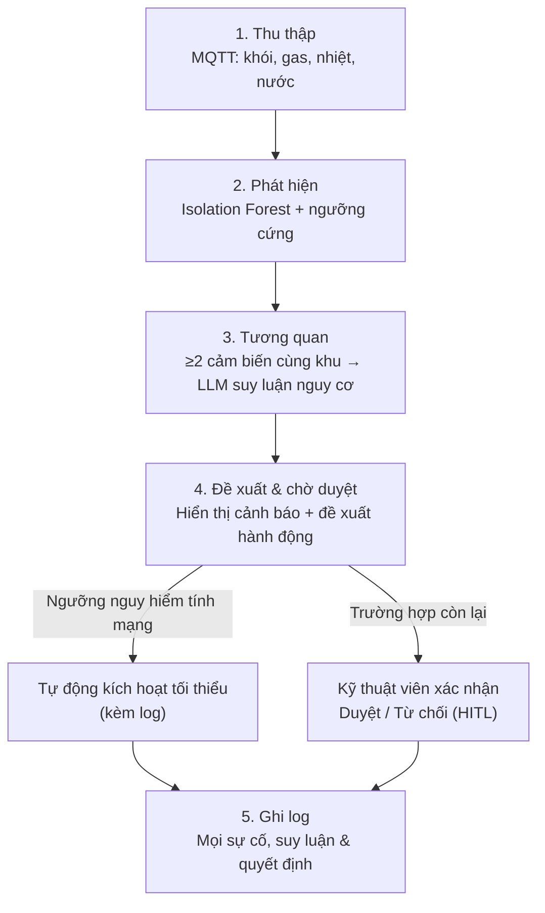

# BRIEF — SC-04: SentinelIoT
*AI Agent Phát Hiện Bất Thường Cảm Biến IoT (Rò Gas, Cháy, Ngập Nước)*

---

### 1. Vấn đề

Ban quản lý (BQL) tòa nhà hiện nhận cảnh báo từ cảm biến khói/gas/nhiệt/nước **rời rạc theo từng điểm**, không có hệ thống nào phân tích tương quan giữa chúng. Hậu quả: khi 1 cảm biến lỗi hoặc báo trễ nhưng cảm biến khác ở cùng khu vực đã có tín hiệu bất thường, BQL không biết để xử lý sớm — nguy cơ bỏ sót sự cố cháy/rò gas giai đoạn đầu. Ngược lại, rule đơn lẻ (ví dụ cảm biến nhạy do bụi/hơi nước) gây báo động nhiễu liên tục, khiến đội kỹ thuật mất tin tưởng và bỏ qua cảnh báo thật.

### 2. Người dùng chính

**Kỹ thuật viên Ban quản lý tòa nhà** — người trực tiếp theo dõi hệ thống cảm biến 24/7 và là người ra quyết định cuối cùng (duyệt/từ chối) với mọi lệnh điều khiển thiết bị vật lý.

### 3. Giải pháp — luồng chính của Agent

1. **Thu thập**: Agent nhận liên tục dữ liệu từ 4 loại cảm biến (khói, gas, nhiệt, ngập nước) qua MQTT.
2. **Phát hiện**: So sánh với baseline bình thường của từng khu (Isolation Forest) + ngưỡng vật lý cứng (rule-threshold).
3. **Tương quan**: Nếu ≥ 2 cảm biến cùng khu bất thường cùng lúc (ví dụ nhiệt tăng + khói tăng), agent suy luận nguy cơ cụ thể (LLM reasoning), kèm dữ liệu gốc làm căn cứ.
4. **Đề xuất & chờ duyệt**: Hiển thị cảnh báo + hành động đề xuất (đóng van, kích chuông...) cho kỹ thuật viên; **chờ xác nhận (HITL)** trước khi thực thi, trừ ngưỡng nguy hiểm tính mạng đã định trước thì tự động kích hoạt tối thiểu kèm log.
5. **Ghi log**: Mọi sự cố, suy luận, và quyết định (kể cả từ chối) được lưu lại để truy vết sau này.

**Sơ đồ minh họa:**

### 4. Phạm vi

**Làm:**
- Tập trung 2 kịch bản nguy hiểm chính: **cháy** (nhiệt + khói) và **rò gas** (gas + nhiệt).
- 4 loại cảm biến, dữ liệu **hoàn toàn giả lập** qua MQTT simulator.
- Dashboard 2 vai trò (Cư dân xem / Kỹ thuật BQL xử lý), HITL bắt buộc, log sự cố.

**Chủ động không làm:**
- Không điều khiển thiết bị vật lý thật — mọi lệnh actuator chạy trên môi trường mô phỏng.
- Không làm mô phỏng lan truyền sự cố không gian hay gợi ý lộ trình sơ tán.
- Không dùng LSTM, Digital Twin hay dữ liệu real-world (Building Data Genome, UK-DALE...) cho bản demo.

### 5. Cách đo thành công

*Đo trên bộ kịch bản mô phỏng của nhóm (có inject anomaly có kiểm soát), không phải dữ liệu production thật — vì sản phẩm chạy 100% trên môi trường giả lập trong 5 tuần.*

| Chỉ số | Mục tiêu | Cách đo |
|---|---|---|
| Tỷ lệ bắt đúng sự cố đã inject (recall) | ≥ 90% trên kịch bản cháy + rò gas | `classification_report` trên tập test, chạy ≥ 20 kịch bản/loại |
| Báo động nhầm (false positive) | ≤ 1 lần/ngày mô phỏng (24h dữ liệu baseline bình thường) | Đếm số cảnh báo Trung bình trở lên khi không có anomaly inject |
| Thời gian từ lúc anomaly xảy ra đến lúc cảnh báo hiển thị | ≤ 3 giây (đo trung bình, môi trường local/demo) | Chênh lệch timestamp log, lấy trung bình trên ≥ 20 lần |

### 6. Phân công nhóm (đề xuất theo kỹ năng đã khai báo — nhóm điều chỉnh lại nếu cần)

| Thành viên | Mảng phụ trách | Căn cứ |
|---|---|---|
| **Hoàng Minh** (Trưởng nhóm) | Backend + điều phối kỹ thuật, LangGraph pipeline | Backend, Communication, đã học IoT (FPT Software x Bách Khoa) |
| **Nguyễn Đức Trọng** | Cảm biến & MQTT simulator, Anomaly Detection (Isolation Forest) | Chuyên ngành Điện tử — phù hợp mô phỏng đặc tính cảm biến thật |
| **Vũ Quang Dũng** | Data pipeline vào DB + Prompt Engineering cho LLM correlation | Data Analysis, Data Engineering, Prompt Engineering |
| **Nguyễn Hữu Mạnh** | Frontend Dashboard (2 vai trò) + UI/UX | Backend, UI/UX Design, Product/Project Management |

---

