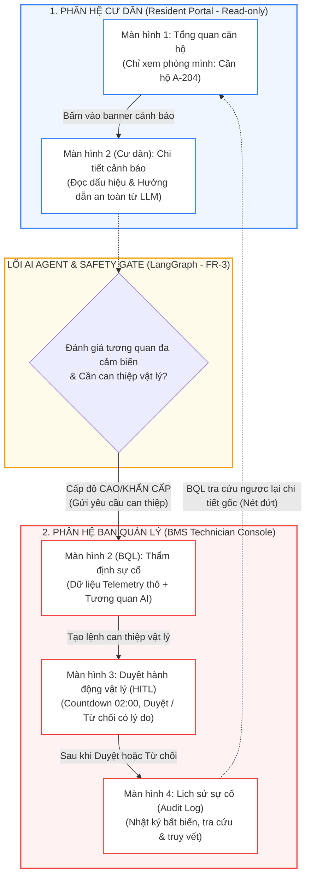

# BẢN ĐẶC TẢ THIẾT KẾ WIREFRAME & UI FLOW v2.0
## Bài toán: SC-04 — [SentinelIoT](https://sentineliot.vercel.app/) (AI Agent Giám sát & Điều phối An toàn Chung cư)
*Tái cấu trúc: Phân định rạch ròi 2 Phân hệ: Cư dân (Resident App) & Ban Quản Lý (BMS Technician Console)*
*Căn cứ: `02_prd_v3.md` (Mục 2-3: Core User Flows, FR-3, FR-5, FR-8)*

---

## 1. NGUYÊN TẮC THIẾT KẾ PHÂN PHÂN HỆ

Nhằm đảm bảo an toàn vận hành và bảo vệ tính mạng cư dân theo tiêu chuẩn chung cư thông minh, SentinelIoT phân định tuyệt đối ranh giới quyền lực:

1. **Phân hệ Cư dân (Resident Portal):**
   - **Tư tưởng chủ đạo:** *Quan sát không gian sống cá nhân & Hướng dẫn cứu nạn khẩn cấp*.
   - **Quyền hạn:** Hoàn toàn **Chỉ đọc (Read-only)**. Cư dân không có thẩm quyền điều khiển hạ tầng cơ điện tòa nhà (không có nút ngắt van gas trung tâm hay tắt chuông báo động tòa nhà).
   - **Giao diện:** Tối giản, tập trung vào trực quan hóa nguy cơ và hành động sơ tán an toàn. Mở giao diện [Cư dân A101](https://sentineliot.vercel.app/#cu-dan-a101) hoặc [Cư dân A204](https://sentineliot.vercel.app/#cu-dan-a204).

2. **Phân hệ Ban Quản Lý (BMS Operations Console):**
   - **Tư tưởng chủ đạo:** *Thẩm định bằng chứng kỹ thuật, Ra quyết định có trách nhiệm (HITL) & Truy vết pháp lý*.
   - **Quyền hạn:** Kỹ thuật viên có quyền phê duyệt/từ chối hành động tác động vật lý xuống tòa nhà.
   - **Giao diện:** Hiển thị chi tiết số liệu cảm biến thô (telemetry), hệ số tương quan AI, đồng hồ đếm ngược an toàn và sổ nhật ký bất biến. Mở giao diện [Kỹ thuật BQL](https://sentineliot.vercel.app/#ky-thuat-bql).

---

## 2. MA TRẬN PHÂN QUYỀN VÀ TRÁCH NHIỆM (RACI MATRIX)

| Chức năng / Màn hình | Cư dân (Resident) | Kỹ thuật BQL (Technician) | Lõi AI Agent |
| :--- | :---: | :---: | :---: |
| **Xem trạng thái cảm biến căn hộ A-204** | **A, R** (Accountable, Responsible) | **I** (Informed) | **S** (Supports data feed) |
| **Xem hướng dẫn thoát hiểm AI sinh ra** | **A, R** (Thực hiện sơ tán) | **I** (Theo dõi tiến độ) | **R** (Generates guidance) |
| **Thẩm định dữ liệu số thô đa cảm biến** | **N/A** (Ẩn để tránh hoang mang) | **A, R** (Bắt buộc kiểm tra) | **R** (Computes correlation) |
| **Phê duyệt lệnh vật lý khẩn cấp (HITL)** | ⛔ **BỊ CHẶN HOÀN TOÀN** | **A, R** (Chịu trách nhiệm bấm) | **C** (Recommends action) |
| **Tra cứu Nhật ký sự cố bất biến** | **I** (Chỉ xem lịch sử căn hộ mình) | **A, R** (Toàn quyền tra cứu toàn khu) | **R** (Appends audit logs) |

---

## 3. THIẾT KẾ CHI TIẾT THEO TỪNG PHÂN HỆ

### PHÂN HỆ 1: CƯ DÂN (RESIDENT APP)

#### Màn hình 1 — Tổng quan cảm biến căn hộ (Cư dân)
- **Tiêu đề:** `SentinelIoT — Căn hộ A-204`.
- **Banner trạng thái:** `Trạng thái khu: Trung bình` kèm `Cập nhật realtime`.
- **4 Thẻ cảm biến căn hộ:**
  - `Khói: 12 ppm — ổn định`
  - `Gas: 3% LEL — bình thường`
  - `Nhiệt độ: 38°C — đang tăng` *(Báo động thị giác bằng tone màu cam/đỏ nhạt)*
  - `Ngập nước: 0 cm — bình thường`
- **Banner cảnh báo gần nhất:**
  - `Cảnh báo gần nhất: Nhiệt + khói tăng cùng lúc`
  - Nút bấm: `Nhấn để xem hướng dẫn xử lý →` (Dẫn thẳng tới Màn hình 2).
- **Lịch sử cảnh báo riêng của căn hộ:** `10:02 Trung bình · 09:40 Thấp · Hôm qua 22:15 Thấp`.

#### Màn hình 2 — Chi tiết cảnh báo & Hướng dẫn an toàn (Cư dân)
- **Mức nguy hiểm:** `CAO — Căn hộ A-204`.
- **Dấu hiệu phát hiện:**
  - `Nhiệt độ: 52°C (tăng 8°C/phút)`
  - `Khói: 38 ppm (gấp 3 lần mức bình thường của khu)`
- **Lý do giải thích:** `Nhiệt và khói cùng tăng trong 60 giây gần nhất tại cùng khu vực.`
- **Hướng dẫn cứu nạn từ LLM:**
  - `Hướng dẫn: rời khu vực, không dùng thang máy`
  - `Nhấn để xem hướng dẫn đầy đủ →` (Bật sơ đồ thoát nạn thang bộ gần nhất).
- **Ranh giới:** Cư dân không có nút can thiệp thiết bị. Quy trình xử lý vật lý chuyển sang Kỹ thuật BQL.

---

### PHÂN HỆ 2: BAN QUẢN LÝ (BMS TECHNICIAN CONSOLE)

#### Màn hình 2 (BQL) — Thẩm định Telemetry & Tương quan AI
- **Đối tượng:** Kỹ sư trực ban PCCC / BMS.
- **Dữ liệu kỹ thuật:**
  - Telemetry chi tiết từ các node `TEMP-204`, `SMOKE-204`.
  - Hệ số tương quan đa cảm biến: `r = 0.94` (PRD FR-3).
  - Tự động đẩy Ticket khẩn sang Màn hình 3.

#### Màn hình 3 — Xác nhận hành động vật lý (HITL, Kỹ thuật BQL)
- **Top bar:** `Xác nhận hành động vật lý` | Badge `Kỹ thuật BQL`.
- **Banner:** `Mức nguy hiểm: CAO — Tầng 2, Khu A-204`.
- **Dữ liệu gốc (Bắt buộc hiển thị):**
  - `Nhiệt = 52°C (ngưỡng 50°C) | Khói = 38 ppm (baseline 12 ppm)`
  - `Nguồn: cảm biến TEMP-204, SMOKE-204 (Hardware signature verified)`
- **Lý do suy luận:** `Nhiệt tăng 8°C/phút kèm khói tăng 3 lần baseline → nguy cơ cháy cao`.
- **Hành động đề xuất & Countdown:**
  - `Hành động đề xuất: kích chuông khu A-204 + đóng van gas tầng 2`.
  - `Thời gian còn lại để xác nhận: 02:00` (Đếm ngược).
- **Quyết định con người (HITL):**
  - Nút **[ Duyệt ]**: Kích hoạt bộ điều khiển PLC/Relay.
  - Nút **[ Từ chối + nhập lý do ]**: Mở form bắt buộc ghi nhận lý do từ chối (PRD FR-5).
  - 🔒 **Quy tắc:** Tuyệt đối không có nút duyệt hàng loạt.

#### Màn hình 4 — Lịch sử sự cố (Kỹ thuật BQL)
- **Header:** `Lịch sử sự cố` + Dropdown `Lọc ▾` (theo khu, mức độ).
- **Bảng Log sự cố (Immutable Audit Trail - PRD FR-8):**
  - `Hôm nay 10:02` | `A-204` | `Cao` | `Nhiệt+khói` | `Đã duyệt`
  - `Hôm nay 09:40` | `B-110` | `Trung bình` | `Gas vượt ngưỡng` | `Đã xem`
  - `Hôm qua 22:15` | `A-204` | `Thấp` | `Nhiệt dao động` | `Đã xem`
  - `12/11 08:05` | `C-301` | `Khẩn cấp` | `Gas vượt ngưỡng tính mạng` | `Tự động` (Highlight đỏ)
- **Truy vết trách nhiệm:** Nhấn vào bất kỳ dòng nào mở toàn bộ lịch sử: raw telemetry, AI inference log, nhân viên duyệt, thời gian thi hành.

---

## 4. SƠ ĐỒ KẾT NỐI UI FLOW & PHÂN LUỒNG TƯƠNG TÁC

