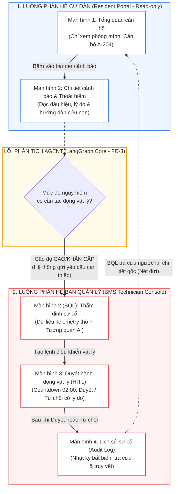

# WIREFRAME & UI FLOW v2.0 — SC-04: SentinelIoT
## Phân luồng Kiến trúc Độc lập: Phân hệ Cư dân & Phân hệ Ban Quản Lý (BQL)
**Phiên bản:** v2.0 | **Căn cứ:** `02_prd_v3.md` (User Flows 2-3, FR-3, FR-5, FR-8)

## Demo SentinelIoT

[Mở demo SentinelIoT](https://sentineliot.vercel.app/). Bản demo sử dụng dữ liệu IoT mô phỏng.

- [Cư dân A101](https://sentineliot.vercel.app/#cu-dan-a101)
- [Cư dân A204](https://sentineliot.vercel.app/#cu-dan-a204)
- [Kỹ thuật BQL](https://sentineliot.vercel.app/#ky-thuat-bql)
- [Luồng RBAC](https://sentineliot.vercel.app/#luong-rbac)

---

## 1. TỔNG QUAN KIẾN TRÚC PHÂN LUỒNG & DỮ LIỆU TELEMETRY

### 1.1 Cấu trúc Dữ liệu Cảm biến chuẩn (Sensor Telemetry Schema)
Hệ thống SentinelIoT tiếp nhận luồng dữ liệu thời gian thực (chu kỳ lấy mẫu 3 giây/lần) với các trường dữ liệu chuẩn xác như sau:

| Trường dữ liệu | Kiểu | Đơn vị / Ý nghĩa | Ngưỡng an toàn | Ngưỡng báo động |
| :--- | :---: | :--- | :--- | :--- |
| `timestamp` | String | Thời gian thực (YYYY-MM-DD HH:MM:SS) | - | - |
| `unix_time` | Integer | Bước nhảy thời gian (0, 3, 6, 9, 12, 15...) | Chu kỳ 3s | Mất kết nối > 15s |
| `can_ho` | String | Mã căn hộ/vị trí (`A101`, `A204`, `B110`, `C301`) | Toàn tòa nhà | - |
| `nhiet_do_C` | Float | Nhiệt độ môi trường (°C) | 20°C - 35°C | $\ge 50^\circ\text{C}$ hoặc tăng $> 5^\circ\text{C}/\text{phút}$ |
| `khoi_ppm` | Float | Nồng độ khói (ppm) | &lt; 15 ppm | $\ge 35\text{ ppm}$ (gấp 3 lần baseline) |
| `gas_pct_lel` | Float | Nồng độ khí gas cháy (% LEL) | &lt; 2% LEL | $\ge 10\%\text{ LEL}$ |
| `muc_nuoc` | Float | Mực nước ngập sàn (cm) | &lt; 1.0 cm | $\ge 10.0\text{ cm}$ |
| `nhan` | String | Nhãn phân loại sự cố từ Agent | `binh_thuong` | `nguy_co_chay`, `ro_ri_gas`, `ngap_nuoc` |

### 1.2 Cơ chế Giả lập Đăng nhập (Demo Persona Switcher)
Nhằm phục vụ đánh giá Demo Day nhanh chóng mà không làm gián đoạn trải nghiệm bằng form đăng nhập mật khẩu, hệ thống trang bị thanh **Demo Persona Switcher** ở đầu trang cho phép chuyển đổi tức thì giữa các danh tính:
1. **👤 Cư dân A101 (Tài khoản An toàn):** Trải nghiệm giao diện cư dân với dữ liệu mẫu `binh_thuong` (Nhiệt: 24.44°C, Khói: 5.49 ppm, Gas: 0.364%, Nước: 0.47 cm).
2. **⚠️ Cư dân A204 (Tài khoản Sự cố Cháy):** Trải nghiệm giao diện cư dân nhận cảnh báo đỏ `nguy_co_chay` (Nhiệt: 52.00°C, Khói: 38.00 ppm), xem lý do AI và quy trình thoát nạn.
3. **🛡️ Kỹ thuật viên BMS (Tài khoản Toàn quyền):** Trải nghiệm giao diện BQL với bảng giám sát toàn tòa nhà, điểm duyệt can thiệp vật lý HITL (Countdown 02:00) và Sổ nhật ký Audit Log bất biến.

```
                                  [ HỆ THỐNG CẢM BIẾN IoT TÒA NHÀ ]
                                                │
                                                ▼
                               [ LÕI AI AGENT (LangGraph Core - FR-3) ]
                                   Phân tích tương quan đa cảm biến
                                                │
                 ┌──────────────────────────────┴──────────────────────────────┐
                 ▼                                                             ▼
     [ 1. PHÂN HỆ CƯ DÂN ]                                          [ 2. PHÂN HỆ BAN QUẢN LÝ ]
       (Resident Mobile/Web)                                           (BMS Technician Console)
  • Phạm vi: Căn hộ A101 / A204                                   • Phạm vi: Toàn bộ tòa nhà (A101, A204, B110...)
  • Quyền: Read-only & Safety Guide                              • Quyền: HITL Action, Hardware Control & Audit
  • Luồng: MH-1 (Tổng quan) → MH-2 (Hướng dẫn)                   • Luồng: MH-2 (Chi tiết) → MH-3 (HITL) → MH-4 (Audit)
```

---

## 2. MA TRẬN SO SÁNH 2 PHÂN HỆ

| Tiêu chí | 1. Phân hệ Cư dân (Resident) | 2. Phân hệ Ban Quản Lý (BQL) |
| :--- | :--- | :--- |
| **Đối tượng sử dụng** | Cư dân sinh sống tại căn hộ (`A-204`) | Kỹ sư vận hành BMS, Trực ban PCCC tòa nhà |
| **Giao diện trải nghiệm** | Mobile Web / Resident App tối giản, trực quan | Bảng điều khiển Operations Dashboard màn hình lớn |
| **Phạm vi dữ liệu** | Giới hạn duy nhất trong căn hộ của mình | Toàn bộ các phân khu, hành lang, tầng hầm và căn hộ |
| **Quyền can thiệp thiết bị**| 🔒 **0% (Zero Control)**: Không có nút điều khiển van, chuông | ⚡ **Có thẩm quyền duyệt**: Ra lệnh vật lý thông qua cơ chế HITL |
| **Các màn hình sở hữu** | **Màn hình 1** (Tổng quan cảm biến căn hộ)<br>**Màn hình 2** (Chi tiết cảnh báo & hướng dẫn an toàn) | **Màn hình 2** (Thẩm định Telemetry & tương quan AI)<br>**Màn hình 3** (Duyệt hành động vật lý HITL)<br>**Màn hình 4** (Lịch sử sự cố & Audit Log bất biến) |
| **Ràng buộc an toàn PRD** | Không nhìn thấy quy trình duyệt lệnh hay dữ liệu căn hộ khác | **Cấm duyệt hàng loạt (FR-5)**; Countdown timeout `02:00`; Log bất biến (FR-8) |

---

## 3. THIẾT KẾ CHI TIẾT THEO PHÂN HỆ

### PHẦN I: PHÂN HỆ CƯ DÂN (RESIDENT APP)

#### Màn hình 1 — Tổng quan cảm biến căn hộ (Cư dân)
* **Mục tiêu:** Cung cấp cho cư dân cái nhìn tổng quan về chất lượng không khí và an toàn môi trường bên trong căn hộ của mình theo thời gian thực.
* **Cấu trúc Wireframe:**
  * **Header:** Định danh `SentinelIoT` (trái) và `Căn hộ A-204` (phải).
  * **Banner trạng thái khu:** `Trạng thái khu: Trung bình` (nền cam pastel `#FDF4E7`, viền `#E6C59E`, chữ `#9C5B17`) kèm chỉ báo `Cập nhật realtime` nhấp nháy.
  * **Lưới 4 thẻ cảm biến (Grid 2x2):**
    * *Khói:* `12 ppm — ổn định` (xanh pastel).
    * *Gas:* `3% LEL — bình thường` (xanh pastel).
    * *Nhiệt độ (Active Alert):* `38°C — đang tăng` (nền đỏ/hồng nhạt `#FAECE9`, viền `#EAAEA8` báo động gia nhiệt).
    * *Ngập nước:* `0 cm — bình thường` (xanh pastel).
  * **Banner cảnh báo gần nhất (CTA Card):**
    * Tiêu đề: `Cảnh báo gần nhất: Nhiệt + khói tăng cùng lúc`.
    * Hành động: `Nhấn để xem hướng dẫn xử lý →` (Chuyển sang **Màn hình 2**).
  * **Lịch sử cảnh báo khu mình:** Danh sách tóm tắt: `10:02 Trung bình · 09:40 Thấp · Hôm qua 22:15 Thấp`.

```
========================= [ GIAO DIỆN CƯ DÂN: MÀN HÌNH 1 ] =========================
+-------------------------------------------------------------------------------+
|  SentinelIoT                                                     Căn hộ A-204 |
+-------------------------------------------------------------------------------+
|  Trạng thái khu: Trung bình                                  Cập nhật realtime |
+-------------------------------------------------------------------------------+
|  +--------------------------------+   +--------------------------------+      |
|  | Khói                           |   | Gas                            |      |
|  | 12 ppm — ổn định               |   | 3% LEL — bình thường           |      |
|  +--------------------------------+   +--------------------------------+      |
|  | Nhiệt độ                       |   | Ngập nước                      |      |
|  | 38°C — đang tăng  [WARNING]    |   | 0 cm — bình thường             |      |
|  +--------------------------------+   +--------------------------------+      |
+-------------------------------------------------------------------------------+
|  [!] Cảnh báo gần nhất: Nhiệt + khói tăng cùng lúc                             |
|  Nhấn để xem hướng dẫn xử lý an toàn →                                        |
+-------------------------------------------------------------------------------+
|  Lịch sử cảnh báo khu mình                                                    |
|  10:02 Trung bình · 09:40 Thấp · Hôm qua 22:15 Thấp                           |
+-------------------------------------------------------------------------------+
```

---

#### Màn hình 2 — Chi tiết cảnh báo & Hướng dẫn an toàn (Góc nhìn Cư dân)
* **Mục tiêu:** Cung cấp thông tin minh bạch, dễ hiểu và hướng dẫn thoát nạn chuẩn xác cho cư dân; tuyệt đối không đưa các công cụ điều khiển hạ tầng kỹ thuật cho cư dân.
* **Cấu trúc Wireframe:**
  * **Top Bar:** Nút `← Quay lại` + Tiêu đề `Chi tiết cảnh báo`.
  * **Banner mức nguy hiểm:** `Mức nguy hiểm: CAO` (Tone đỏ pastel `#FAECE9`, viền `#EAAEA8`).
  * **Khối Dấu hiệu phát hiện:**
    * Nhiệt độ: `52°C (tăng 8°C/phút)`
    * Khói: `38 ppm (gấp 3 lần mức bình thường của khu)`
  * **Khối Lý do suy luận (Ngôn ngữ người dùng):**
    * Tiêu đề: `Lý do: nguy cơ cháy tại khu A-204`
    * Chi tiết: `"Nhiệt và khói cùng tăng trong 60 giây gần nhất tại cùng khu vực."`
  * **Khối Hướng dẫn an toàn từ LLM:**
    * Tiêu đề: `Hướng dẫn: rời khu vực, không dùng thang máy`
    * Nút liên kết: `Nhấn để xem hướng dẫn đầy đủ →` (Bật sơ đồ lối thoát hiểm tầng 2).
  * **Ràng buộc an toàn:** Cư dân kết thúc quy trình tại đây. Hệ thống tự động chuyển tiếp dữ liệu kỹ thuật sang Phân hệ Ban Quản Lý.

```
========================= [ GIAO DIỆN CƯ DÂN: MÀN HÌNH 2 ] =========================
+-------------------------------------------------------------------------------+
|  ← Quay lại                                                 Chi tiết cảnh báo |
+-------------------------------------------------------------------------------+
|  Mức nguy hiểm: CAO                                                           |
+-------------------------------------------------------------------------------+
|  Dấu hiệu phát hiện                                                           |
|  • Nhiệt độ: 52°C (tăng 8°C/phút)                                             |
|  • Khói: 38 ppm (gấp 3 lần mức bình thường của khu)                           |
+-------------------------------------------------------------------------------+
|  Lý do: nguy cơ cháy tại khu A-204                                            |
|  Nhiệt và khói cùng tăng trong 60 giây gần nhất tại cùng khu vực.             |
+-------------------------------------------------------------------------------+
|  Hướng dẫn: rời khu vực, không dùng thang máy                                 |
|  Nhấn để xem hướng dẫn đầy đủ →                                               |
+-------------------------------------------------------------------------------+
|  Khuyến cáo an toàn: Cư dân sơ tán theo thang bộ, không tự ý can thiệp thiết bị.|
+-------------------------------------------------------------------------------+
```

---

### PHẦN II: PHÂN HỆ BAN QUẢN LÝ (BMS TECHNICIAN CONSOLE)

#### Màn hình 2 — Thẩm định Telemetry & Tương quan AI (Góc nhìn Kỹ thuật BQL)
* **Mục tiêu:** Kỹ thuật viên đối soát dữ liệu thô, mã định danh cảm biến và đánh giá mức độ tin cậy của thuật toán tương quan đa cảm biến (PRD FR-3).
* **Đặc điểm mở rộng cho BQL:**
  * Hiển thị mã cảm biến: `TEMP-204`, `SMOKE-204`, `GAS-204`.
  * Hiển thị hệ số tương quan thời gian thực: `r = 0.94`, vượt ngưỡng báo động 60s.
  * Tự động tạo Ticket yêu cầu duyệt hành động vật lý khẩn cấp chuyển sang **Màn hình 3**.

---

#### Màn hình 3 — Xác nhận hành động vật lý (HITL - Kỹ thuật BQL)
* **Mục tiêu:** Điểm chốt chặn con người (Human-In-The-Loop) để ngăn chặn AI tự ý kích hoạt các thiết bị vật lý gây náo loạn hoặc tổn thất tài sản khi chưa được người có trách nhiệm xác thực.
* **Cấu trúc Wireframe:**
  * **Top Bar:** `Xác nhận hành động vật lý` + Badge quyền lực `Kỹ thuật BQL`.
  * **Banner mức nguy hiểm & vị trí:** `Mức nguy hiểm: CAO — Tầng 2, Khu A-204`.
  * **Khối Dữ liệu gốc (Bắt buộc hiển thị, không ẩn giấu):**
    * `Nhiệt = 52°C (ngưỡng 50°C) | Khói = 38 ppm (baseline 12 ppm)`
    * `Nguồn: cảm biến TEMP-204, SMOKE-204 (Hardware signature verified)`
  * **Khối Lý do suy luận:**
    * `Nhiệt tăng 8°C/phút kèm khói tăng 3 lần baseline → nguy cơ cháy cao`
  * **Khối Hành động đề xuất + Đếm ngược Timeout:**
    * Hành động: `kích chuông khu A-204 + đóng van gas tầng 2`
    * Đồng hồ đếm ngược: `Thời gian còn lại để xác nhận: 02:00` (Nếu hết 2 phút không phản hồi, hệ thống kích hoạt chế độ Fail-safe theo chính sách an toàn tòa nhà).
  * **2 nút ra quyết định:**
    * `[ Duyệt ]`: Xanh lá `#EAF6EA`, viền `#B6DFB8`, chữ `#236B2B`.
    * `[ Từ chối + nhập lý do ]`: Đỏ pastel `#FAECE9`, viền `#EAAEA8`, chữ `#932924` (Bắt buộc nhập lý do vào modal để ghi nhận trách nhiệm).
  * ⚠️ **Nguyên tắc an toàn (PRD FR-5):** **Tuyệt đối không có nút "Duyệt hàng loạt"**.

```
========================== [ GIAO DIỆN BQL: MÀN HÌNH 3 ] ==========================
+-------------------------------------------------------------------------------+
|  Xác nhận hành động vật lý                                       Kỹ thuật BQL |
+-------------------------------------------------------------------------------+
|  Mức nguy hiểm: CAO — Tầng 2, Khu A-204                                       |
+-------------------------------------------------------------------------------+
|  Dữ liệu gốc (Bắt buộc đối chiếu)                                             |
|  Nhiệt = 52°C (ngưỡng 50°C) | Khói = 38 ppm (baseline 12 ppm)                  |
|  Nguồn: cảm biến TEMP-204, SMOKE-204                                          |
+-------------------------------------------------------------------------------+
|  Lý do suy luận                                                               |
|  Nhiệt tăng 8°C/phút kèm khói tăng 3 lần baseline → nguy cơ cháy cao           |
+-------------------------------------------------------------------------------+
|  Hành động đề xuất: kích chuông khu A-204 + đóng van gas tầng 2               |
|  Thời gian còn lại để xác nhận: 02:00 (Đang đếm ngược)                        |
+-------------------------------------------------------------------------------+
|        [      Duyệt      ]        |        [  Từ chối + nhập lý do  ]         |
+-------------------------------------------------------------------------------+
| * Ràng buộc an toàn: Không hỗ trợ duyệt hàng loạt (PRD FR-5).                 |
+-------------------------------------------------------------------------------+
```

---

#### Màn hình 4 — Lịch sử sự cố (Kỹ thuật BQL)
* **Mục tiêu:** Bảng nhật ký bất biến (Immutable Audit Trail) phục vụ công tác thanh tra, bàn giao ca trực và điều tra pháp lý sau sự cố (PRD FR-8).
* **Cấu trúc Wireframe:**
  * **Top Bar:** `Lịch sử sự cố` + Dropdown `Lọc ▾` (theo khu/tầng, mức độ nguy hiểm, khoảng thời gian).
  * **Bảng dữ liệu:**
    * Dòng 1: `Hôm nay 10:02` | `A-204` | `Cao` | `Nhiệt+khói` | `Đã duyệt`
    * Dòng 2: `Hôm nay 09:40` | `B-110` | `Trung bình` | `Gas vượt ngưỡng` | `Đã xem`
    * Dòng 3: `Hôm qua 22:15` | `A-204` | `Thấp` | `Nhiệt dao động` | `Đã xem`
    * Dòng 4 (Báo động khẩn tự động): `12/11 08:05` | `C-301` | `Khẩn cấp` | `Gas vượt ngưỡng tính mạng` | `Tự động` (nền đỏ nhạt).
  * **Tính năng Drill-down (Truy vết):** Nhấn vào 1 dòng để xem chi tiết toàn diện: Telemetry gốc, Prompt của AI, người duyệt lệnh, thời điểm thi hành xuống PLC.

```
========================== [ GIAO DIỆN BQL: MÀN HÌNH 4 ] ==========================
+-------------------------------------------------------------------------------+
|  Lịch sử sự cố                                                          Lọc ▾ |
+-------------------------------------------------------------------------------+
| Thời gian       | Khu   | Mức       | Lý do                   | Trạng thái    |
+-----------------+-------+-----------+-------------------------+---------------+
| Hôm nay 10:02   | A-204 | Cao       | Nhiệt+khói              | Đã duyệt      |
| Hôm nay 09:40   | B-110 | Trung bình| Gas vượt ngưỡng         | Đã xem        |
| Hôm qua 22:15   | A-204 | Thấp      | Nhiệt dao động          | Đã xem        |
| 12/11 08:05     | C-301 | Khẩn cấp  | Gas vượt ngưỡng tính mạng| Tự động       |
+-----------------+-------+-----------+-------------------------+---------------+
| Nhấn vào 1 dòng để xem chi tiết: dữ liệu gốc, lý do, người duyệt, kết quả     |
+-------------------------------------------------------------------------------+
```

---

## 4. SƠ ĐỒ KẾT NỐI UI FLOW & PHÂN LUỒNG TƯƠNG TÁC



---

## 5. DIỄN GIẢI QUY TRÌNH PHỐI HỢP LIÊN PHÂN HỆ

1. **Khởi phát từ Căn hộ:** Khi cảm biến nhiệt và khói tại căn hộ `A-204` cùng tăng đồng thời, cư dân mở **Màn hình 1** thấy trạng thái chuyển cam → Bấm vào banner để sang **Màn hình 2** đọc khuyến cáo sơ tán an toàn.
2. **Kích hoạt quy trình BQL:** Song song đó, Agent kích hoạt luồng cảnh báo trên bảng điều khiển của **Ban Quản Lý**.
3. **Thẩm định & Quyết định HITL:** Kỹ thuật viên BQL xem **Màn hình 3**, đối chiếu dữ liệu gốc từ `TEMP-204` và `SMOKE-204`. Kỹ thuật viên có 2 phút để đưa ra quyết định Duyệt hoặc Từ chối lệnh đóng van gas / kích chuông.
4. **Lưu trữ Audit Trail:** Bất kể kết quả là Duyệt, Từ chối hay Hết giờ (Timeout), bản ghi đều được lập tức đóng băng vào **Màn hình 4 (Lịch sử sự cố)**, không ai có quyền can thiệp hay tẩy xóa.
